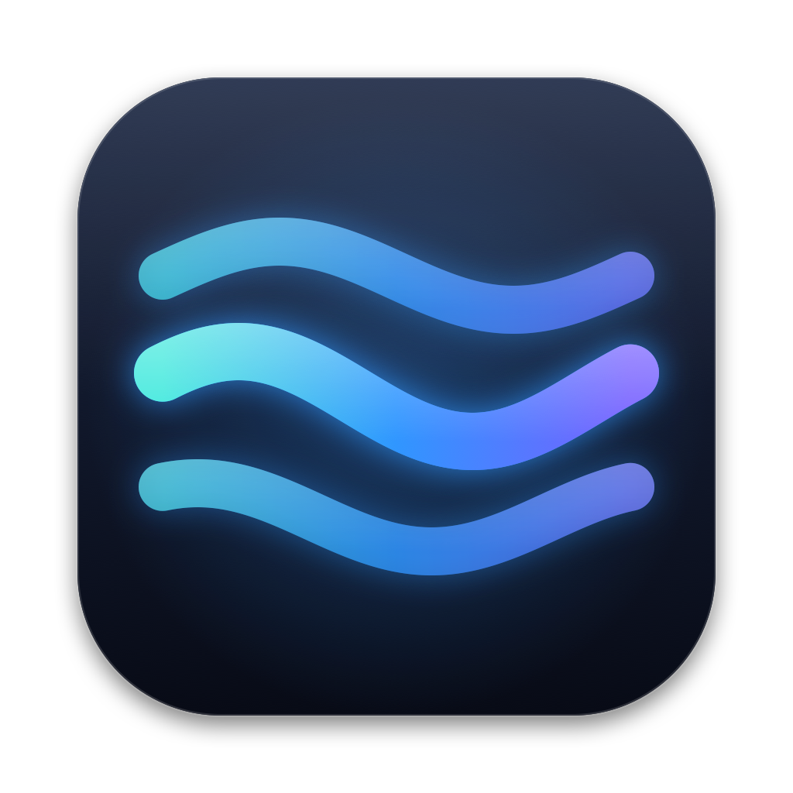

# AirWave — Releases

Official builds of **AirWave**: offline air-gesture media and volume controls for macOS, powered by Apple Vision. Every frame is processed on-device; nothing leaves your Mac.

## Gestures

| Gesture | Action |
|---|---|
| Grab (open hand, then close it) | Play / Pause |
| Wave left / right (quick open-palm flick) | Previous / Next Track |
| Pinch and slide up / down | System volume |
| Thumbs down, hold 1 s | Sleep the camera |
| `Ctrl + Opt + S` | Sleep / wake the camera |

Works with Spotify and Apple Music. Lives in the menu bar, with an optional calibration HUD that shows the camera feed and the tracked hand skeleton.

## Requirements

macOS 14 Sonoma or later, Apple Silicon, and a built-in or connected camera.

## Installation

1. Download the latest `AirWave.dmg` (or `AirWave-v*.zip`) from [Releases](../../releases/latest).
2. Open it and **drag `AirWave.app` to `/Applications`**.

### First launch (Gatekeeper)

AirWave is ad-hoc signed, not notarized, so macOS blocks the first launch. Either:

- Right-click `AirWave.app` → **Open** → **Open**, or
- Run in Terminal: `xattr -cr /Applications/AirWave.app`

You only need to do this once. Then allow **Camera** access when asked (and **Automation** for Spotify / Music the first time a gesture controls them).

## Updates

AirWave checks this repository for a new release at launch and installs it automatically. You can also choose **Check for Updates** from the menu bar icon. After an update, macOS may ask for Camera access again.

## License

Copyright © 2026 Ayush Sharma. Licensed under the [PolyForm Noncommercial License 1.0.0](https://polyformproject.org/licenses/noncommercial/1.0.0). Binaries only; this repository contains no source code.
